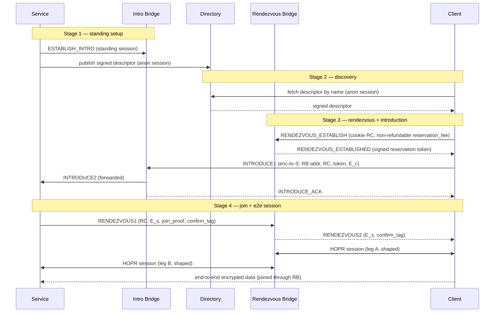

# RFC-0016: Onion Services over HOPR

- **RFC Number:** 0016
- **Title:** Onion Services over HOPR
- **Status:** Raw
- **Author(s):** Tibor Csóka (@Teebor-Choka)
- **Created:** 2026-07-05
- **Updated:** 2026-10-27
- **Version:** v0.9.0 (Raw)
- **Supersedes:** none
- **Related Links:** [RFC-0002](../RFC-0002-mixnet-keywords/0002-mixnet-keywords.md),
  [RFC-0003](../RFC-0003-hopr-overview/0003-hopr-overview.md),
  [RFC-0004](../RFC-0004-hopr-packet-protocol/0004-hopr-packet-protocol.md),
  [RFC-0005](../RFC-0005-proof-of-relay/0005-proof-of-relay.md),
  [RFC-0006](../RFC-0006-hopr-mixer/0006-hopr-mixer.md),
  [RFC-0007](../RFC-0007-economic-reward-system/0007-economic-reward-system.md),
  [RFC-0008](../RFC-0008-session-protocol/0008-session-protocol.md),
  [RFC-0009](../RFC-0009-session-start-protocol/0009-session-start-protocol.md),
  [RFC-0010](../RFC-0010-automatic-path-discovery/0010-automatic-path-discovery.md),
  [RFC-0011](../RFC-0011-application-protocol/0011-application-protocol.md),
  [RFC-0014](../RFC-0014-path-finding/0014-path-finding.md),
  RFC-0015

## 1. Abstract

This RFC specifies **HOPR Onion Services**: a scheme for offering a network
service whose provider and consumers remain mutually anonymous. No relaying node
learns both endpoints' network identities, and neither endpoint learns the
other's location or node identity. It is the HOPR-native counterpart of Tor
onion services [06], built on the HOPR mixnet rather than on circuit-switched
onion routing.

The design adopts a two-phase **introduction and rendezvous** architecture. A
service maintains inexpensive standing control sessions to a set of announced
**introduction bridges** and publishes a signed **service descriptor** to a
distributed directory. To connect, a client selects a fresh **rendezvous
bridge**, asks the service to meet it there through an introduction bridge, and
the two parties then exchange data end-to-end encrypted across the rendezvous
bridge, which joins two independent HOPR sessions and observes only ciphertext.
The rendezvous bridge does learn that the two sessions it joins belong to one
connection — this is its function — but it learns neither endpoint's identity,
and mandatory traffic shaping bounds what its vantage yields; the residual risk
is analysed in Section 7. Services are named by self-certifying `.hopr`
addresses derived from an Ed25519 identity key, with an optional ENS-based
human-readable alias layer, and MAY be served by multiple hosts through signed
delegation.

Incentivisation reuses HOPR Proof of Relay
([RFC-0005](../RFC-0005-proof-of-relay/0005-proof-of-relay.md)) for the two
transport legs and the PIX privacy-pool settlement construction
(RFC-0012,
a draft dependency) for the bridge role, so every participant is paid **only
against verifiable service** and without any party learning who paid it. This
document normatively defines service identity and naming, the descriptor format
and directory interface, the bridge announcement and selection rules, the
introduction and rendezvous protocol, the end-to-end handshake, the incentive
and denial-of-service model, and the associated security properties. The
mechanics of the distributed directory are delegated to a companion RFC.

## 2. Motivation

HOPR ([RFC-0003](../RFC-0003-hopr-overview/0003-hopr-overview.md)) provides
sender anonymity toward relays and the destination, a recipient-initiated reply
channel through pseudonyms and single-use reply blocks (SURBs), per-hop
incentivisation via Proof of Relay
([RFC-0005](../RFC-0005-proof-of-relay/0005-proof-of-relay.md)), and session
semantics ([RFC-0008](../RFC-0008-session-protocol/0008-session-protocol.md),
[RFC-0009](../RFC-0009-session-start-protocol/0009-session-start-protocol.md))
over the mixnet. What it does not provide is a way for **two mutually anonymous
parties** to communicate: in every existing HOPR session one endpoint (the exit
node) is addressable and its node identity is known to the initiator. A service
that wants to be reachable without revealing where it runs has no in-protocol
mechanism today.

Tor solves the analogous problem for circuit onion routing with introduction
points, rendezvous points, and a hidden-service directory [06]. HOPR needs an
equivalent faithful to its own primitives — fixed-size Sphinx packets [03],
SURB-based replies, probabilistic ticket payments, and on-chain node
announcement — rather than a port of a circuit-switched design. The broader
lineage is the mix-network line of work beginning with Chaum [02].

This RFC defines that mechanism. It closes five concrete gaps left open by the
existing stack:

1. **Mutual anonymity.** A rendezvous role lets neither endpoint learn the
   other, while a client-chosen rendezvous point per connection keeps announced
   infrastructure out of the bulk-traffic path.
2. **Naming and discovery.** Self-certifying addresses plus a signed-descriptor
   directory give services a stable, verifiable identity and a way to be found.
3. **Multi-host serving.** Signed delegation lets several hosts serve one
   service identity without sharing the long-term key.
4. **Bridge incentives.** The splice/availability role is not covered by Proof
   of Relay or PIX as-is; this RFC adds a negotiated, service-conditional,
   anonymity-preserving bridge fee.
5. **Abuse resistance.** A mutually anonymous inbound channel invites spam;
   payment-gated introduction and descriptor-level access control price and gate
   it.

## 3. Terminology

The keywords "MUST", "MUST NOT", "REQUIRED", "SHALL", "SHALL NOT", "SHOULD",
"SHOULD NOT", "RECOMMENDED", "MAY", and "OPTIONAL" in this document are to be
interpreted as described in [01] when, and only when, they appear in all
capitals, as shown here.

General mixnet and HOPR glossary terms (mixnet, node, path, hop, relay node,
onion routing, cover traffic, unlinkability, Proof of Relay, channel, mixer,
session) are defined in
[RFC-0002](../RFC-0002-mixnet-keywords/0002-mixnet-keywords.md). The packet-layer
terms **SURB**, **sender pseudonym**, and **ReplyOpener** are defined in
[RFC-0004](../RFC-0004-hopr-packet-protocol/0004-hopr-packet-protocol.md). This
document additionally defines:

- **Onion service** (also **service**): a service reachable over HOPR whose host
  location and node identity are hidden from its clients and from relaying
  nodes.
- **Service identity key**: the long-term Ed25519 key pair `id_S` that names and
  authenticates a service. Its public part yields the self-certifying address.
- **Self-certifying address**: the `.hopr` string derived from the `id_S` public
  key (Section 4.2.1). Authenticity of any signed material is checkable against
  it without external trust.
- **Service descriptor**: the signed document that maps a service to its current
  introduction bridges and connection parameters (Section 4.3).
- **Bridge relayer** (also **bridge**): a HOPR node that has announced the
  capability to act as an introduction bridge and/or a rendezvous bridge.
- **Introduction bridge** (**IB**): a bridge that holds a standing control
  session with a service and forwards introduction requests to it.
- **Rendezvous bridge** (**RB**): a bridge, chosen freshly by a client per
  connection, that joins the client's and the service's HOPR sessions and relays
  the end-to-end-encrypted payload between them.
- **Session join**: the generic operation by which a bridge binds two HOPR
  sessions bearing a shared join token and relays opaque payload between them.
  Onion-service rendezvous is one use of this operation; a bridge performing a
  join is not told what higher-level purpose it serves.
- **Rendezvous cookie** (**RC**): a single-use random join token that binds a
  client's and a service's sessions at a rendezvous bridge.
- **Introduction request**: the client-produced, service-encrypted message that
  names the rendezvous bridge and carries the client's end-to-end handshake
  half.
- **End-to-end (e2e) session**: the session established directly between client
  and service, encrypted under a key the bridge does not possess, carried over
  the two joined HOPR sessions.
- **Directory**: the distributed store from which descriptors are published and
  fetched (interface in Section 4.3; mechanics in a companion RFC).
- `||` denotes byte-string concatenation. `|x|` denotes the size of `x` in
  bytes. Multi-byte integers are big-endian unless stated otherwise. Character
  strings in double quotes use ASCII single-byte encoding. `CSPRNG` is a
  cryptographically secure pseudorandom number generator. `H`, `KDF`, and the
  symmetric and curve primitives are fixed in Appendix 1.

## 4. Specification

### 4.1 Overview

An onion service connection involves five roles, all HOPR nodes except the
directory abstraction and the privacy pool:

- **Service** `S` — the provider, running on or behind a HOPR node with funded
  payment channels (Section 4.9 discusses a gateway variant).
- **Client** `C` — the consumer.
- **Introduction bridge** `IB` — announced in the descriptor; holds a standing
  control session with `S`.
- **Rendezvous bridge** `RB` — chosen fresh by `C`; performs the session join.
- **Directory** and **privacy pool** `W` — supporting infrastructure
  (Sections 4.3 and 4.7).

The lifecycle has four stages: (1) the service publishes a descriptor and opens
standing sessions to its introduction bridges; (2) the client fetches and
verifies the descriptor; (3) the client establishes a rendezvous reservation and
introduces itself to the service through an introduction bridge; (4) the service
joins the rendezvous and the parties run an end-to-end session across the join.



Every arrow between two HOPR nodes is itself a multi-hop HOPR path (0–3
intermediate hops each way, per
[RFC-0004](../RFC-0004-hopr-packet-protocol/0004-hopr-packet-protocol.md)),
subject to mixing
([RFC-0006](../RFC-0006-hopr-mixer/0006-hopr-mixer.md)) and paid via Proof of
Relay ([RFC-0005](../RFC-0005-proof-of-relay/0005-proof-of-relay.md)). The
diagram shows the logical overlay, not the packet path. It depicts the
**single-path happy case**; it elides bridge discovery (`CAP_QUERY`/`CAP_RESPONSE`,
Section 4.4.1), the leg-A PIX payment exchange (Section 4.5.5), multipath (`M`
parallel legs, Section 4.6.1), and the partial-establishment / negotiation-failure
path (Sections 4.5.4, 4.6.1).

The onion-service control messages defined in this RFC are carried in the HOPR
application protocol
([RFC-0011](../RFC-0011-application-protocol/0011-application-protocol.md)) under
the **Onion Service Control Protocol (OSCP)** application tag
`0x0000000000000002`, the first of the user-defined tags `0x2`–`0xd`. That range
has no global registry, so a deployment MUST treat tag selection as a
coordination concern (Section 6). The end-to-end data session uses the
session-data protocol
([RFC-0008](../RFC-0008-session-protocol/0008-session-protocol.md)) inside the
e2e-encrypted channel.

### 4.2 Service identity, naming and delegation

#### 4.2.1 Identity key and self-certifying address

A service is identified by an Ed25519 [07] key pair `id_S = (sk_S, pk_S)`. The
service's canonical **self-certifying address** is:

```
address = base32( version || pk_S || checksum ) || ".hopr"
version  : u8         (current value 0x01)
pk_S     : [u8; 32]   Ed25519 public key (canonical encoding)
checksum : [u8; 2]    truncated H(".hopr-checksum" || version || pk_S)
```

`base32` uses the RFC 4648 [12] lowercase alphabet without padding. The trust
anchor is the full 32-byte `pk_S`; the checksum protects only against
transcription errors and confers no security (a 16-bit checksum is trivially
matched by a brute-forced lookalike key, so users MUST compare full addresses,
not rely on visual similarity). The address is self-certifying: any descriptor
or delegation presented for it MUST verify under `pk_S` (directly or through a
delegation chain rooted at `pk_S`), so a malicious host cannot serve a different
key under the same name. A client MUST reject any `version` below its configured
minimum, so a future hardened format cannot be silently downgraded.

#### 4.2.2 Human-readable aliases (ENS, optional)

Human-readable names are OPTIONAL and layered on top of the self-certifying
address, which remains authoritative. A service MAY register an ENS [08] name
(or subdomain) whose `hopr` text record contains its `.hopr` address. A client
resolving an alias MUST fetch the descriptor for the `.hopr` address the record
points to and MUST verify it against that address. ENS resolution is a discovery
convenience only; it confers no authority and MUST NOT override the
self-certifying check. No bespoke registry contract is introduced by this RFC.

#### 4.2.3 Multi-host serving via delegation

A service MAY be served by more than one host without sharing `sk_S`. The
identity key signs a **delegation certificate** authorising a per-host
signing/operating key for a bounded window:

```
DelegationCert {
  version         : u8,           // 0x01
  service_pubkey  : [u8; 32],     // pk_S this cert is bound to (MUST match address)
  serial          : u64,          // unique per (service, delegate); monotonic
  delegate_pubkey : [u8; 32],     // Ed25519 per-host key
  not_before      : u64,          // UNIX seconds
  not_after       : u64,          // UNIX seconds; MUST NOT exceed not_before + MAX_DELEGATION
  capabilities    : u16,          // bit 0 = publish descriptor, bit 1 = run intro point,
                                  // bit 2 = terminate e2e session; other bits reserved
  signature       : [u8; 64]      // Ed25519 by sk_S over all preceding fields
}
```

A host holding a valid `DelegationCert` MAY perform exactly the actions whose
capability bit is set, during `[not_before, not_after)`. Verifiers MUST reject a
delegated action whose corresponding bit is unset and MUST treat any unknown
capability bit as unauthorised (deny by default). `service_pubkey` MUST equal
the `pk_S` of the dialled address, preventing cross-identity cert reuse.

Capability bit 2 (terminate e2e session) additionally requires the delegate to
hold the per-period handshake static private key. Because `S_s` is derived from
`sk_S` (Section 4.3.1), a delegate cannot recompute it; therefore a service
authorising bit 2 MUST provision the delegate with the **current period's** `S_s`
private half over a secure channel, re-provisioning each period. Provisioning
only the per-period key (never `sk_S`) bounds the exposure of a compromised
delegate to that period and to the actions its bits permit.
Descriptors served by a delegate MUST embed the certificate so clients verify
the chain to `pk_S`. Revocation before `not_after` is by descriptor rotation (a
fresh, higher-`revision` descriptor omitting the revoked delegate) combined with
short windows: `not_after − not_before` MUST NOT exceed `MAX_DELEGATION`
(default 7 days). Because there is no online revocation list, `sk_S` compromise
recovery relies on short windows; long-lived certificates are NOT RECOMMENDED.

### 4.3 Service descriptor and directory interface

#### 4.3.1 Descriptor content

A service descriptor is a signed document. Its signed fields are:

```
Descriptor {
  version          : u8,               // 0x01
  address          : self-certifying address (Section 4.2.1)
  revision         : u64,              // monotonic; higher supersedes lower
  published_at     : u64,              // UNIX seconds, absolute publication time
  lifetime         : u32,              // validity in seconds from published_at
  handshake_static : [u8; 32],         // per-period service X25519 static key S_s (below)
  intro_points     : IntroSection,     // see below (public: plain list; private: encrypted+padded)
  rendezvous_set   : [[u8; 32]; r],    // packet_pubkeys the service vouches for as rendezvous
                                      //   bridges (Section 4.4); rotated per period
  session_caps     : u16,              // bitfield: session modes + supported traffic classes (interactive/stream/bulk)
  min_dos_level    : u8,               // monotonic floor a client MUST enforce
  dos_policy       : DosPolicy,        // Section 4.8
  delegation       : DelegationCert?,  // present iff signed by a delegate
  signature        : [u8; 64]          // Ed25519 over all preceding fields
}

IntroPoint {
  node_id       : [u8; 32],   // IB HOPR off-chain public key (routing target)
  intro_enc_key : [u8; 32],   // X25519 public key; PRIVATE HALF HELD ONLY BY THE SERVICE
  expiry        : u64         // UNIX seconds
}
```

`signature` is by `sk_S`, or by `delegation.delegate_pubkey` (capability bit 0
set) when `delegation` is present. `revision` and `published_at` together resist
rollback: a client MUST prefer the highest valid `revision`, MUST reject a
descriptor whose `published_at + lifetime` has elapsed, and MUST reject a
descriptor whose `published_at` is not consistent with the current directory
period (Section 4.3.2).

The `IntroSection` has two forms selected by a one-byte discriminant:

- **Public service**: a plain `[IntroPoint; c]` where `c` is the real count.
  Since a public service's introduction bridges are usable by anyone, their
  identities are not secret and no padding is applied; the client reads the list
  directly.
- **Private service**: the real `[IntroPoint; c]` list is AEAD-encrypted to the
  authorised-client key set (Section 4.8.2) and then padded to a fixed
  `INTRO_SLOTS` (default 8) ciphertext-sized slots, so an outsider who cannot
  decrypt learns neither the intro points nor their count. An authorised client
  decrypts to obtain the real list. Padding is meaningful only here, because only
  here are the entries hidden.

`rendezvous_set` lists the `packet_pubkey`s of the rendezvous bridges the service
vouches for (Section 4.4). A private service MAY carry it inside the same
encrypted `IntroSection` as the intro points so only authorised clients see it.
The set is rotated across periods to limit how much of the service's traffic any
one bridge sees, and a client MAY augment it with bridges of its own
(Section 4.4.3).

`intro_enc_key` is the X25519 public key used to encrypt the introduction blob
(Section 4.5.3). **Its private half is held only by the service (or a delegate
with capability bit 1); the introduction bridge stores only the public value and
cannot decrypt the blob.** `ESTABLISH_INTRO` (Section 4.5.1) proves the service
possesses this private half.

`handshake_static` (`S_s`) is rotated **every period** together with the
publication key (Section 4.3.2), derived deterministically as
`S_s = X25519_clamp(H("hopr-onion-hsk" || sk_S || period))`. Rotation prevents a
party who reads two periods' descriptor bodies from linking them by a static
handshake key.

#### 4.3.2 Blinded publication keying

To prevent the directory from enumerating services or linking a descriptor to
its long-term identity, the descriptor is published under a **blinded key**
derived from `pk_S` and the current time period, following the Tor v3 key
blinding approach [06]:

```
period   = floor(now / PERIOD_LENGTH)   // PERIOD_LENGTH default 86400 s
h        = clamp( H("hopr-blind" || pk_S || period) )              // per-period scalar; do not separately reduce mod L
pk_blind = h · pk_S                      // Ed25519 POINT scalar-multiplication (not addition)
slot     = H(pk_blind || period)         // directory address
```

The descriptor stored at `slot` is signed by the correspondingly blinded private
key `a_blind = (h · a_S) mod L`, and verifies under `pk_blind` with standard
Ed25519. The **exact** construction — scalar clamping and reduction modulo the
group order `L`, point (not scalar) multiplication, and canonical `pk_blind`
encoding — is normatively pinned in
RFC-0015 §4.3;
implementations MUST follow it exactly (a scalar-addition or unreduced/unclamped
scalar yields either linkable slots or unverifiable signatures).

Enumeration guarantee, stated precisely: because `h` derives from
`pk_S`, only a party that already knows the `.hopr` address can compute `slot`.
This makes the directory **crawl-resistant** — it cannot be swept for service
identities. It does **not** hide a service from an adversary who already guesses
or knows the address and can therefore compute the slot and confirm activity;
that residual confirmation channel is discussed in Section 7.

#### 4.3.3 Directory interface

This RFC defines the interface any directory layer MUST provide; the concrete
distributed hash table (replication, retention, storage incentives, and the
blinding construction of Section 4.3.2) is specified in a companion RFC (proposed
**RFC-0015, HOPR Distributed Directory**; drafted alongside this RFC). The directory holds
**only service descriptors** (Section 4.3.1), stored at *blinded* slots so
services cannot be enumerated. Bridges are **not** in the directory — they are
discovered by direct capability negotiation and vouched for in service
descriptors (Section 4.4), so there is no unblinded bridge index to crawl. The
interface is:

- `STORE(slot, record)` and `LOAD(slot) -> record?` — a single request format
  serves both. Publication and fetch MUST be **indistinguishable on the wire**:
  a publisher writes using the same request shape as a reader, authorising the
  write with a signature inside the blinded-signed record body rather than a
  distinct opcode, so a directory node cannot tell a service's re-publish from a
  client's fetch.
- Both operations MUST be performed over **anonymous HOPR sessions** (a forward
  path with SURBs for the reply, per
  [RFC-0004](../RFC-0004-hopr-packet-protocol/0004-hopr-packet-protocol.md)), so
  directory nodes learn neither party's location.

The directory layer MUST provide `k`-fold replication across the nodes
responsible for a `slot`, with the responsible set rotating per `period`. Taking
the highest `revision`/`sequence` across at least two replicas defeats a **single**
lying replica, but not an adversary that controls the whole responsible set. Two
properties are therefore REQUIRED of RFC-0015 and this RFC's guarantees are
conditional on them:

- **Ungrindable responsible-set assignment.** Because a slot is a public function
  of a known key, an adversary could otherwise grind Sybil node IDs to land
  adjacent to a target slot and eclipse it. RFC-0015 MUST make responsible-set
  membership non-grindable toward a chosen slot (e.g. VRF-based assignment or IDs
  bound to an announced on-chain identity) and MUST state a minimum `k`, an explicit
  honest-fraction assumption, and a client fetch quorum of at least the assumed
  dishonest bound plus one — not the bare "two" above, which is a floor.
- **Replica-side monotonicity.** `sequence`/`revision` monotonicity is *not*
  enforced by the record format; a validly-signed old record can be re-stored to
  a forgetful replica. Replicas MUST retain the latest per-key value, MUST reject
  a STORE whose `sequence`/`revision` is not greater than what they hold, and MUST
  run anti-entropy so a fresh write (including a tombstone) propagates to the
  responsible set before stale replicas can serve a superseded record.

STORE/LOAD wire indistinguishability (above) is **shape-only**: a replica that
inspects a request body can tell a validly-signed higher-`sequence` write (a
heartbeat) from a read, so it does not hide *that* a given slot is being
refreshed — only the account, and only for blinded (descriptor) slots. Do not
rely on it to hide bridge heartbeats.

To bound the per-slot demand time-series any single replica observes, clients
SHOULD spread queries across the replica set. The directory interface MUST expose
an anti-abuse hook (fetch payment or proof-of-work) that RFC-0015 MUST specify;
without it, an adversary who knows an address can flood its slot. Because only
blinded descriptor slots exist (bridges are not in the directory), flooding is
targeted-only — an adversary must already know a service's address to compute its
slot. Services MUST jitter publication time within the period and MUST NOT derive
`published_at` from a high-resolution wall clock, so re-publication does not
become a liveness or clock fingerprint.

### 4.4 Bridge relayers: announcement, eligibility and selection

_TBD._

### 4.5 Introduction and rendezvous protocol

_TBD._

### 4.6 End-to-end handshake and session

_TBD._

### 4.7 Incentivisation

_TBD._

### 4.8 Denial-of-service resistance and access control

_TBD._

### 4.9 Bridge session management (join, shaping and SURB handling)

_TBD._

### 4.10 Guard relays for endpoint legs

_TBD._

## 5. Design Considerations

_TBD._

## 6. Compatibility

_TBD._

## 7. Security Considerations

_TBD._

## 8. Drawbacks

_TBD._

## 9. Alternatives

_TBD._

## 10. Unresolved Questions

_TBD._

## 11. Future Work

_TBD._

## 12. References

_TBD._

## 13. Appendix 1: Cryptographic Instantiation

_TBD._

## 14. Appendix 2: HOPR Session Binding

_TBD._

