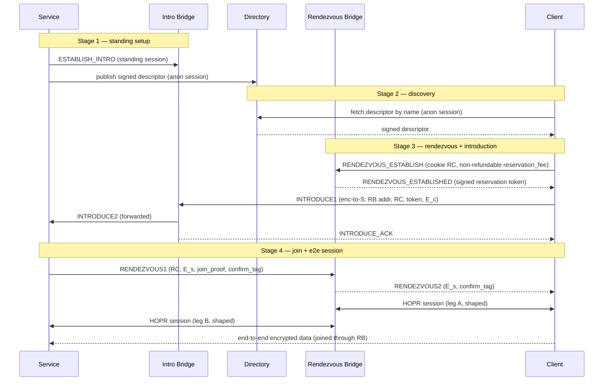

# RFC-0016: Onion Services over HOPR

- **RFC Number:** 0016
- **Title:** Onion Services over HOPR
- **Status:** Raw
- **Author(s):** Tibor Csóka (@Teebor-Choka)
- **Created:** 2026-07-05
- **Updated:** 2026-10-27
- **Version:** v0.9.0 (Raw)
- **Supersedes:** none
- **Related Links:** [RFC-0002](../RFC-0002-mixnet-keywords/0002-mixnet-keywords.md),
  [RFC-0003](../RFC-0003-hopr-overview/0003-hopr-overview.md),
  [RFC-0004](../RFC-0004-hopr-packet-protocol/0004-hopr-packet-protocol.md),
  [RFC-0005](../RFC-0005-proof-of-relay/0005-proof-of-relay.md),
  [RFC-0006](../RFC-0006-hopr-mixer/0006-hopr-mixer.md),
  [RFC-0007](../RFC-0007-economic-reward-system/0007-economic-reward-system.md),
  [RFC-0008](../RFC-0008-session-protocol/0008-session-protocol.md),
  [RFC-0009](../RFC-0009-session-start-protocol/0009-session-start-protocol.md),
  [RFC-0010](../RFC-0010-automatic-path-discovery/0010-automatic-path-discovery.md),
  [RFC-0011](../RFC-0011-application-protocol/0011-application-protocol.md),
  [RFC-0014](../RFC-0014-path-finding/0014-path-finding.md),
  RFC-0015

## 1. Abstract

This RFC specifies **HOPR Onion Services**: a scheme for offering a network
service whose provider and consumers remain mutually anonymous. No relaying node
learns both endpoints' network identities, and neither endpoint learns the
other's location or node identity. It is the HOPR-native counterpart of Tor
onion services [06], built on the HOPR mixnet rather than on circuit-switched
onion routing.

The design adopts a two-phase **introduction and rendezvous** architecture. A
service maintains inexpensive standing control sessions to a set of announced
**introduction bridges** and publishes a signed **service descriptor** to a
distributed directory. To connect, a client selects a fresh **rendezvous
bridge**, asks the service to meet it there through an introduction bridge, and
the two parties then exchange data end-to-end encrypted across the rendezvous
bridge, which joins two independent HOPR sessions and observes only ciphertext.
The rendezvous bridge does learn that the two sessions it joins belong to one
connection — this is its function — but it learns neither endpoint's identity,
and mandatory traffic shaping bounds what its vantage yields; the residual risk
is analysed in Section 7. Services are named by self-certifying `.hopr`
addresses derived from an Ed25519 identity key, with an optional ENS-based
human-readable alias layer, and MAY be served by multiple hosts through signed
delegation.

Incentivisation reuses HOPR Proof of Relay
([RFC-0005](../RFC-0005-proof-of-relay/0005-proof-of-relay.md)) for the two
transport legs and the PIX privacy-pool settlement construction
(RFC-0012,
a draft dependency) for the bridge role, so every participant is paid **only
against verifiable service** and without any party learning who paid it. This
document normatively defines service identity and naming, the descriptor format
and directory interface, the bridge announcement and selection rules, the
introduction and rendezvous protocol, the end-to-end handshake, the incentive
and denial-of-service model, and the associated security properties. The
mechanics of the distributed directory are delegated to a companion RFC.

## 2. Motivation

HOPR ([RFC-0003](../RFC-0003-hopr-overview/0003-hopr-overview.md)) provides
sender anonymity toward relays and the destination, a recipient-initiated reply
channel through pseudonyms and single-use reply blocks (SURBs), per-hop
incentivisation via Proof of Relay
([RFC-0005](../RFC-0005-proof-of-relay/0005-proof-of-relay.md)), and session
semantics ([RFC-0008](../RFC-0008-session-protocol/0008-session-protocol.md),
[RFC-0009](../RFC-0009-session-start-protocol/0009-session-start-protocol.md))
over the mixnet. What it does not provide is a way for **two mutually anonymous
parties** to communicate: in every existing HOPR session one endpoint (the exit
node) is addressable and its node identity is known to the initiator. A service
that wants to be reachable without revealing where it runs has no in-protocol
mechanism today.

Tor solves the analogous problem for circuit onion routing with introduction
points, rendezvous points, and a hidden-service directory [06]. HOPR needs an
equivalent faithful to its own primitives — fixed-size Sphinx packets [03],
SURB-based replies, probabilistic ticket payments, and on-chain node
announcement — rather than a port of a circuit-switched design. The broader
lineage is the mix-network line of work beginning with Chaum [02].

This RFC defines that mechanism. It closes five concrete gaps left open by the
existing stack:

1. **Mutual anonymity.** A rendezvous role lets neither endpoint learn the
   other, while a client-chosen rendezvous point per connection keeps announced
   infrastructure out of the bulk-traffic path.
2. **Naming and discovery.** Self-certifying addresses plus a signed-descriptor
   directory give services a stable, verifiable identity and a way to be found.
3. **Multi-host serving.** Signed delegation lets several hosts serve one
   service identity without sharing the long-term key.
4. **Bridge incentives.** The splice/availability role is not covered by Proof
   of Relay or PIX as-is; this RFC adds a negotiated, service-conditional,
   anonymity-preserving bridge fee.
5. **Abuse resistance.** A mutually anonymous inbound channel invites spam;
   payment-gated introduction and descriptor-level access control price and gate
   it.

## 3. Terminology

The keywords "MUST", "MUST NOT", "REQUIRED", "SHALL", "SHALL NOT", "SHOULD",
"SHOULD NOT", "RECOMMENDED", "MAY", and "OPTIONAL" in this document are to be
interpreted as described in [01] when, and only when, they appear in all
capitals, as shown here.

General mixnet and HOPR glossary terms (mixnet, node, path, hop, relay node,
onion routing, cover traffic, unlinkability, Proof of Relay, channel, mixer,
session) are defined in
[RFC-0002](../RFC-0002-mixnet-keywords/0002-mixnet-keywords.md). The packet-layer
terms **SURB**, **sender pseudonym**, and **ReplyOpener** are defined in
[RFC-0004](../RFC-0004-hopr-packet-protocol/0004-hopr-packet-protocol.md). This
document additionally defines:

- **Onion service** (also **service**): a service reachable over HOPR whose host
  location and node identity are hidden from its clients and from relaying
  nodes.
- **Service identity key**: the long-term Ed25519 key pair `id_S` that names and
  authenticates a service. Its public part yields the self-certifying address.
- **Self-certifying address**: the `.hopr` string derived from the `id_S` public
  key (Section 4.2.1). Authenticity of any signed material is checkable against
  it without external trust.
- **Service descriptor**: the signed document that maps a service to its current
  introduction bridges and connection parameters (Section 4.3).
- **Bridge relayer** (also **bridge**): a HOPR node that has announced the
  capability to act as an introduction bridge and/or a rendezvous bridge.
- **Introduction bridge** (**IB**): a bridge that holds a standing control
  session with a service and forwards introduction requests to it.
- **Rendezvous bridge** (**RB**): a bridge, chosen freshly by a client per
  connection, that joins the client's and the service's HOPR sessions and relays
  the end-to-end-encrypted payload between them.
- **Session join**: the generic operation by which a bridge binds two HOPR
  sessions bearing a shared join token and relays opaque payload between them.
  Onion-service rendezvous is one use of this operation; a bridge performing a
  join is not told what higher-level purpose it serves.
- **Rendezvous cookie** (**RC**): a single-use random join token that binds a
  client's and a service's sessions at a rendezvous bridge.
- **Introduction request**: the client-produced, service-encrypted message that
  names the rendezvous bridge and carries the client's end-to-end handshake
  half.
- **End-to-end (e2e) session**: the session established directly between client
  and service, encrypted under a key the bridge does not possess, carried over
  the two joined HOPR sessions.
- **Directory**: the distributed store from which descriptors are published and
  fetched (interface in Section 4.3; mechanics in a companion RFC).
- `||` denotes byte-string concatenation. `|x|` denotes the size of `x` in
  bytes. Multi-byte integers are big-endian unless stated otherwise. Character
  strings in double quotes use ASCII single-byte encoding. `CSPRNG` is a
  cryptographically secure pseudorandom number generator. `H`, `KDF`, and the
  symmetric and curve primitives are fixed in Appendix 1.

## 4. Specification

### 4.1 Overview

An onion service connection involves five roles, all HOPR nodes except the
directory abstraction and the privacy pool:

- **Service** `S` — the provider, running on or behind a HOPR node with funded
  payment channels (Section 4.9 discusses a gateway variant).
- **Client** `C` — the consumer.
- **Introduction bridge** `IB` — announced in the descriptor; holds a standing
  control session with `S`.
- **Rendezvous bridge** `RB` — chosen fresh by `C`; performs the session join.
- **Directory** and **privacy pool** `W` — supporting infrastructure
  (Sections 4.3 and 4.7).

The lifecycle has four stages: (1) the service publishes a descriptor and opens
standing sessions to its introduction bridges; (2) the client fetches and
verifies the descriptor; (3) the client establishes a rendezvous reservation and
introduces itself to the service through an introduction bridge; (4) the service
joins the rendezvous and the parties run an end-to-end session across the join.

Every arrow between two HOPR nodes is itself a multi-hop HOPR path (0–3
intermediate hops each way, per
[RFC-0004](../RFC-0004-hopr-packet-protocol/0004-hopr-packet-protocol.md)),
subject to mixing
([RFC-0006](../RFC-0006-hopr-mixer/0006-hopr-mixer.md)) and paid via Proof of
Relay ([RFC-0005](../RFC-0005-proof-of-relay/0005-proof-of-relay.md)). The
diagram shows the logical overlay, not the packet path. It depicts the
**single-path happy case**; it elides bridge discovery (`CAP_QUERY`/`CAP_RESPONSE`,
Section 4.4.1), the leg-A PIX payment exchange (Section 4.5.5), multipath (`M`
parallel legs, Section 4.6.1), and the partial-establishment / negotiation-failure
path (Sections 4.5.4, 4.6.1).

The onion-service control messages defined in this RFC are carried in the HOPR
application protocol
([RFC-0011](../RFC-0011-application-protocol/0011-application-protocol.md)) under
the **Onion Service Control Protocol (OSCP)** application tag
`0x0000000000000002`, the first of the user-defined tags `0x2`–`0xd`. That range
has no global registry, so a deployment MUST treat tag selection as a
coordination concern (Section 6). The end-to-end data session uses the
session-data protocol
([RFC-0008](../RFC-0008-session-protocol/0008-session-protocol.md)) inside the
e2e-encrypted channel.

### 4.2 Service identity, naming and delegation

_TBD._

### 4.3 Service descriptor and directory interface

_TBD._

### 4.4 Bridge relayers: announcement, eligibility and selection

_TBD._

### 4.5 Introduction and rendezvous protocol

_TBD._

### 4.6 End-to-end handshake and session

_TBD._

### 4.7 Incentivisation

_TBD._

### 4.8 Denial-of-service resistance and access control

_TBD._

### 4.9 Bridge session management (join, shaping and SURB handling)

_TBD._

### 4.10 Guard relays for endpoint legs

_TBD._

## 5. Design Considerations

_TBD._

## 6. Compatibility

_TBD._

## 7. Security Considerations

_TBD._

## 8. Drawbacks

_TBD._

## 9. Alternatives

_TBD._

## 10. Unresolved Questions

_TBD._

## 11. Future Work

_TBD._

## 12. References

_TBD._

## 13. Appendix 1: Cryptographic Instantiation

_TBD._

## 14. Appendix 2: HOPR Session Binding

_TBD._

